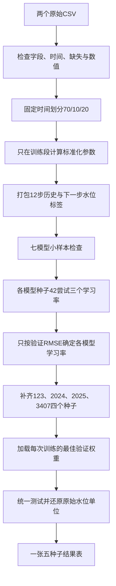

# 任务流程与代码结构

## 1. 先固定当前研究任务

当前主线是TimeXer方法改进。第一阶段只建立任务A的公平对比：淇河（镇平）作为上游信息来源，十二里河作为目标站，预测十二里河下一步闸前水位。A/B不混训，本轮没有任务B。

七个模型各五次随机训练，用同一输入、同一标签时间和同一划分比较。没有提出或实现新的TimeXer改进模块；后续应先分析训练／验证结果，再由用户确定改进思路和相应消融。

## 2. 一条样本是什么

例如，输入00:00、00:30、……、05:30共12条记录，预测06:00的十二里河闸前水位。下一条样本的窗口向后移动30分钟。

每条输入共17通道，顺序如下：

1. 淇河8个物理量：闸前水位、闸后水位、水位差、瞬时流量、孔1、孔2、孔3、孔4实际开度。
2. 三个公共日历特征：日内位置、星期位置、月内周次。
3. 十二里河6个物理量：闸后水位、水位差、瞬时流量、孔1、孔2实际开度、闸前水位。

十二里河闸前水位放最后，仅为适配TimeXer的目标通道约定；变量没有被删除。它在输入里是历史值，在标签里是下一时刻值。水位差也只取历史，不能输入目标时刻水位差。

时间轴一致，因此日历特征只添加一份。水位差可由前后水位计算，属于重复信息，按用户要求保留，不宣称它是额外独立测量。

## 3. 完整流程

本地不执行F至K；用户已授权在云端依次执行这些阶段，并在统一测试后自动画出实测与预测水位对比图。

## 4. 每个文件负责什么

**run.py**只转入训练流程的主程序，不实现网络，也不存放第二套实验设置。用户只需记住这个入口。

**audit_data.py**检查原始副本的指纹、字段、时间连续性、缺失、负开度和水位差一致性。它不平滑、不插值、不改原始文件。结构检查不等于测量真实性已经得到独立核实。

**prepare.py**读取唯一配置，拼接17个输入通道，划分时间段，只用训练段估计标准化参数，再按标签时间打包样本。它保存字段顺序、输入结束时间索引、标签索引、目标时间和标准化参数。

**adapters.py**负责七个模型的统一接口。MLP和LSTM在这里定义；HPA在这里组织双分支并调用原注意力层；其余四种模型从vendor导入。所有模型返回一列水位预测。

**vendor/**保存实际调用的外部模型源码，避免云端导入其他本地仓库。原始源码不在本次整理中重写；来源与逐文件指纹保存在source_manifest.json。

**train.py**是流程编排主程序：设置随机种子、调度独立训练子进程、更新参数、计算验证误差、保存最佳权重、选学习率，最后加载权重完成测试。它调用prepare、adapters、metrics和report。当前没有额外的task_a.py接管层。

**metrics.py**计算MAE、MAPE（百分数）、RMSE和相对保持不变预测的技能分数。MAE是平均偏差大小；MAPE是绝对相对误差的平均百分数，若真实水位包含0则记为空；RMSE会更重地惩罚较大误差。技能分数大于0表示优于“下一步水位等于当前水位”。

**report.py**把五个种子的结果按模型整理到同一张CSV表，并计算均值及样本标准差。标准差反映随机训练波动，不等于跨站点或跨年份的不确定性。

## 5. 数据划分与样本数量

两个文件各16,081条记录，2025-01-01 00:00至2025-12-02 00:00，间隔30分钟。

- 训练标签：2025-01-01 06:00至2025-08-23 11:30，共11,244条。
- 验证标签：2025-08-23 12:00至2025-09-25 23:30，共1,608条。
- 测试标签：2025-09-26 00:00至2025-12-02 00:00，共3,217条。

验证和测试可以读取预测发出前已观测的历史，不能读取未来实测值。测试按滚动单步进行，可以使用刚刚到达的真实水位，并不是将模型输出连续递推数个月。

标准化参数只拟合原始时间轴前11,256条记录。不同变量分别缩放，日历编码保持固定的0至1范围。用户已确认水位m、流量m³/s、开度mm；MAE和RMSE还原到水位m，MAPE以百分数报告。

## 6. 为什么训练49次，表里却是35次

每个模型先用种子42尝试三个学习率，共7×3＝21次。各模型按验证RMSE选定学习率；其中七次最佳种子42训练可直接作为最终第一组结果。

再训练另外四个种子，共7×4＝28次。合计49次不同训练，最终正式报告7×5＝35次模型与种子组合。

其他14个未选中的学习率候选只保留选参记录，不作为五种子正式成绩。训练中不查看测试误差，也不挑最好种子汇报。

## 7. 如何读输出

- 每次运行目录的job.json：哪个模型、哪个种子和学习率。
- epochs.csv：每轮训练目标、验证MAE、验证RMSE及耗时。
- best.pt：验证RMSE最低时的网络参数。
- result.json：训练是否完整结束、最佳轮次和校验值。
- test_metrics.json、test_predictions.csv：最终测试指标及逐时刻预测。
- 统一结果表.csv：按模型排列的五次结果、均值、标准差和保持不变参考。

best.pt只是最佳模型参数，未保存完整优化器和随机状态，不能宣称支持精确断点续训。云端包不带这些本地权重，后续整组从头训练。已有本地11次候选训练及日志仍保留在V2中，不当作完整对比结论。
