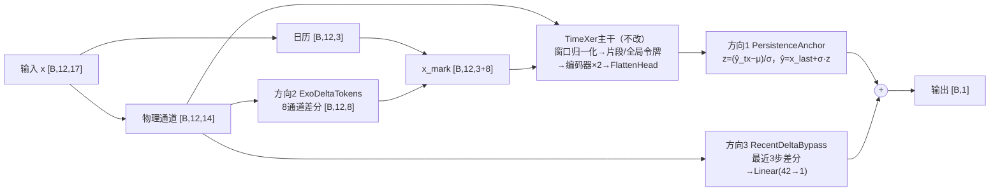

# TimeXer问题诊断与改进方向（只做分析，未改代码）

> 2026-10-29补注：本文写作时未读到 `03_实验结果` 06–11轮。其中方向1（输出参照）、方向2（外部变化幅度）、方向3（线性旁路）以及D1、D4、D5、D6诊断已在06–11轮完成，结论与执行安排以 [05_最终实验计划.md](05_最终实验计划.md) 为准。本文保留作为源码层面的机制分析。

依据：`统一结果表.csv`、`protocol.json`、`packing_audit.json`、`adapters.py`、`vendor/tsl/models/TimeXer.py`、`layers/Embed.py`、`train.py`、`metrics.py`。本地"块细节候选"的代码和日志不在本文件夹内，下文对它的判断只基于你给出的"约0.90% RMSE改善"。

## 0. 结论先行

1. 当前主要矛盾是TimeXer在测试集上不如"水位保持不变"（技能分数 −0.056），模型结构复杂度还没成为瓶颈。七个模型中只有TimeFilter略胜保持不变（+0.023）。
2. 源码层面能找到三条具体机制解释这个现象：输出以窗口均值为参照、外部变量被窗口归一化抹掉了变化幅度、外部信息只经一个全局令牌进入预测。权重衰减会把模型推向"退化解"，而当前退化解是"窗口均值"，不是"保持不变"。
3. 改进顺序建议：先做6项只用训练/验证数据的诊断；再按"输出参照 → 外部变化幅度 → 外部时间分辨率 → 线性增量旁路"逐项加入，每项都可单独消融，TimeXer主干（嵌入、2层编码器、交叉注意力、FlattenHead）保持不动。
4. 0.90%的改善约等于TimeXer五种子测试RMSE的1个标准差（0.034 mm / 3.904 mm ≈ 0.86%），按此幅度推算，测试RMSE约3.869 mm，仍高于保持不变的3.800 mm。它还不能作为方法结论。

## 1. 从现有结果读出的事实

| 模型 | 测试RMSE (mm) | 技能分数 | 五种子RMSE标准差 (mm) | 选中学习率 |
|---|---|---|---|---|
| 保持不变 | 3.800 | 0 | – | – |
| TimeFilter | 3.756 | +0.023 | 0.005 | 3e-4 |
| iTransformer | 3.902 | −0.054 | 0.020 | 1e-3（上边界） |
| TimeXer | 3.904 | −0.056 | 0.034 | 1e-4（下边界） |
| LSTM | 5.593 | −1.18 | 0.516 | 1e-3（上边界） |
| HPA | 9.617 | −5.58 | 1.765 | 1e-3（上边界） |
| MLP | 9.686 | −5.58 | 1.241 | 1e-4（下边界） |
| Informer | 12.962 | −10.90 | 2.189 | 3e-4 |

几点含义：

- TimeXer要追平保持不变需降约2.7% RMSE，要追平TimeFilter需降约3.8%。
- 三个倒置嵌入类模型（TimeXer、iTransformer、TimeFilter）种子间差异极小，且都贴近保持不变。这更像收敛到同一个"平滑版保持不变"的解，而不是学到了不同的动态。
- MAPE约0.0016%，由MAE/MAPE反推水位约142 m（高程）。分母是高程，MAPE几乎没有信息量。

从原始CSV前几行还能看到：十二里河闸前水位在平稳段只有约0.5 mm的抖动，`142.0899963` 反复出现（可能是记录保持值或量化值）；开度为整数mm，长时间不变；流量有约±2 m³/s的噪声。这三点直接影响下文的归一化分析。

## 2. 实验设计存在的问题

**E1 测试集只覆盖一个季节，种子标准差低估了不确定性。** 训练1–8月，验证8月末–9月末，测试9月末–12月初。五种子标准差只反映初始化随机性，不反映时段差异。三个领先模型之间的差距（0.15 mm）需要用时间上的配对检验（例如按天分块的block bootstrap，或Diebold–Mariano检验）判断，单看种子均值不够。

**E2 学习率网格有一半模型落在边界。** TimeXer、MLP选在最小值1e-4，iTransformer、LSTM、HPA选在最大值1e-3。边界解说明真实最优可能在网格外，基线排名（尤其是MLP、HPA、LSTM）有调参不足的成分。且只用种子42选参。改进版和TimeXer基线必须用同一网格，结论才公平；如需扩网格，应对所有模型同时扩。

**E3 全测试段RMSE被平稳段稀释。** 目标闸前水位受本站节制闸调控，大部分时间几乎不变，此时保持不变预测几乎无误差。模型的价值体现在开度或流量变化后的少数时段，但当前只报告全段指标。需要按事件分层报告（见第4节D2）。

**E4 一部分误差在输入中不可观测。** 如果十二里河在 t 到 t+30 min 之间动闸，这个动作不在输入里。这类样本的误差是信息上限，不是模型缺陷。分层时要把"窗口内已发生调度"和"预测区间内才发生调度"分开，后者不能拿来评价模块是否有效。

**E5 验证集小且被反复使用。** 验证集1,608条（约33天），已经用于早停、学习率选择，现在又用于候选模块选择。反复在同一验证集上挑选候选，0.90%这种幅度的改善容易是选择偏差。建议在开始新一轮候选之前写下采纳规则（见第7节）。

**E6 MAPE不提供信息。** 水位约142 m（高程），MAPE≈0.0016%，只是MAE除以142。建议在论文中保留但不作为判据，或改报相对某基准高程的误差（这属于评估脚本，不在本次修改范围）。

**E7 工程层面：加新模型会触发现有版本锁。** `train.py` 的 `fingerprint()` 对 `02_训练流程` 下所有 `.py` 求哈希，新增任何文件都会让已完成的49次训练在 `complete()` 中报"实验版本或权重改变"。`prepare.py` 也会在 `protocol.json` 改动后拒绝运行。因此改进版应放在一个新版本目录中运行（同样数据、同样划分，数据包可确定性重建），并在该版本内重跑TimeXer基线作配对对照（7次训练）。这一点不需要修改训练代码，但要提前规划。

## 3. 从源码找到的模型不足

以下各条都对应 `vendor/tsl/models/TimeXer.py` 或 `adapters.py` 中的具体代码行。

**M1 输出以窗口均值为参照（TimeXer.py 第160–182行）。** 预测值 = 目标12步均值 + 目标12步标准差 × 头部输出 z。要复现"保持不变"，z 必须精确等于 (x_last − mean)/std。权重衰减和dropout都把 z 推向0，而 z=0 对应"预测窗口均值"，这是一个滞后的预测。上涨或下降过程中，窗口均值落后最新值约半个窗口，误差系统性偏大。

**M2 头部dropout作用在标量输出上，造成约10%的系统性收缩。** `FlattenHead` 的顺序是 Linear → Dropout，`pred_len=1`，所以dropout直接随机置零那一个输出。训练时以0.1概率输出0（即窗口均值），否则输出 z/0.9。对平方误差求最优可得 z* = 0.9 × 真实偏差，推理时dropout关闭，预测对窗口均值的偏离被压缩到90%。这和M1叠加，正好表现为"比保持不变差一点"。这是可检验的推断，见D1。

**M3 幅度参照绑定在目标窗口标准差上。** 平稳段目标窗口标准差只有约0.5 mm（标准化后极小），输出 = mean + 极小std × z。闸门刚动作、水位刚开始变化时，模型需要极大的 z 才能输出跳变，而这恰好是短时动态最重要的样本。损失也在反归一化之后计算，平稳窗口给头部的梯度被极小std缩放。

**M4 外部变量的变化幅度被窗口归一化抹掉（TimeXer.py 第158–168行）。** `use_norm` 对全部14个物理通道各自做窗口内标准化，再送入 `DataEmbedding_inverted`。后果有三：开度不变的窗口全部变成0；开度变化50 mm和500 mm在归一化后形状相同，幅度丢失；流量平稳段±2 m³/s的噪声被放大到单位方差，看起来和一次真实调度一样大（分母只有 `+1e-5`）。这是"短时流量和开度变化利用不足"最直接的机制。

**M5 外部信息只经一个全局令牌、以整窗为单位进入。** 每个外部变量的12步被一个 Linear(12→64) 压成一个令牌；只有目标的全局令牌做交叉注意力，4个片段令牌不直接看外部信息；16个外部令牌经softmax加权平均后再进64维。最近一步的动作只是12个输入权重中的一个，再经平均稀释。2层编码器意味着片段令牌最多间接拿到一次外部信息。

**M6 权重衰减对弱信号通路的压制。** 优化器是 `Adam(weight_decay=1e-4)`，即耦合L2，衰减项进入Adam的自适应归一化。损失梯度很小的参数（外部嵌入、交叉注意力中只在少数事件样本上有用的方向）每步会被推回0附近，有效收缩步长接近学习率量级。外部信号本来就稀疏（多数时间闸门不动），所以这条通路最容易被压制。按规则不改优化器，因此对策只能是结构上的：让退化解等于"保持不变"（M1），让有用信号以物理幅度到达，用很小的权重就能利用（M4）。

## 4. 先做的诊断（只用训练/验证集，不改模型，不看测试）

这些诊断决定后面哪些方向值得做。都可以写成独立分析脚本，加载已有 `best.pt` 在验证集上推理，不改训练代码。

| 编号 | 检查什么 | 怎么做 | 支持假设的现象 |
|---|---|---|---|
| D1 | M1、M2输出收缩 | 验证集上回归 (ŷ − 窗口均值) 对 (y − 窗口均值) 的斜率 | 斜率明显小于1，接近0.9 |
| D2 | 误差集中在哪里 | 按以下条件分层算RMSE和技能分数：窗口内本站开度是否变化、上游流量变化幅度分位、目标窗口std分位、\|y − x_last\| 分位 | TimeXer在"窗口内已有调度"层比保持不变差得最多 |
| D3 | M3幅度参照 | 误差对目标窗口std作图 | 低std窗口中、y出现跳变的样本误差大 |
| D4 | M4、M5外部通路 | 验证集置换重要性：分别打乱上游流量、上游开度、本站开度、本站流量 | 开度类置换后RMSE几乎不变，说明模型没用到 |
| D5 | 信息上限 | 训练集上拟合岭回归：输入为 x_last 和14个物理通道最近1–3步差分，目标为 y − x_last；看验证技能分数 | 技能分数为正，说明短时变化中确有可线性提取的信息，TimeXer没吃到 |
| D6 | M6权重衰减 | 记录 `ex_embedding`、`cross_attention` 权重范数；另做一次 wd=0 的诊断训练（只作诊断，不进入主结果） | wd=0时外部通路范数明显变大，且验证RMSE下降 |

D5最重要。如果岭回归在验证集上都不能超过保持不变，说明12步输入中的短时变化信息本身有限，后面所有方向的上限都很低，应先回头看E4（预测区间内的调度不可见）。

## 5. 改进方向（按优先级排序）

排序依据：问题证据是否直接、改动是否最小、是否能单独消融。方向1、2改动最小且证据来自源码；方向3、4只在诊断支持时再做。TimeXer主干（目标片段嵌入、全局令牌、2层自注意力+交叉注意力编码器、FlattenHead）在所有方向中都不改。

### 方向1：保持不变参照（PersistenceAnchor）

- **问题**：M1、M2、M6。输出以窗口均值为参照，权重衰减和头部dropout把输出推向窗口均值，形成滞后，技能分数为负。
- **假设**：如果把退化解从"窗口均值"换成"最新观测值"，同样的主干和训练设置下技能分数至少不低于0，且趋势段误差下降。
- **改进思路**：TimeXer原样前向，得到其反归一化输出 ŷ_tx。在包装模块中按与vendor相同的公式重算目标窗口均值 μ 和标准差 σ，还原头部输出 z = (ŷ_tx − μ)/σ，再改用最新值作参照：ŷ = x_last + σ·z。此时 z=0 对应保持不变，dropout置零和权重衰减收缩都只会收缩"增量"，不会把预测拉回窗口均值。不加可学习参数。
- **修改位置**：输出端。新文件中的独立类，包在 `NativeForecast` 调用 `self.network(...)` 之后、`pred[:, -1, -1:]` 之前。vendor源码不动。
- **预期作用**：消除M2的10%收缩带来的系统性滞后；平稳段与保持不变持平，趋势段改善。D1的斜率应接近1。
- **风险**：模型可能收敛到"几乎只输出保持不变"，技能分数≈0而没有动态增益，这本身是有用的结论，说明瓶颈在信息通路（转向方向2）。"预测增量"在水文预测中是常见做法，单独作为创新点分量不足，论文中应把它写成针对M1/M2的机制修正，而非新结构。
- **可选子消融1b**：σ下限。为缓解M3，用 max(σ, σ_min) 代替 σ，σ_min取训练集上 \|y − x_last\| 的某个分位（换算为标准化单位后写入配置常数）。与1a分开消融，避免两项效果混在一起。

### 方向2：外部变化幅度令牌（ExoDeltaTokens）

- **问题**：M4。窗口归一化让开度不变的窗口变成0，抹掉变化幅度，同时把流量噪声放大成"伪调度"。
- **假设**：如果把流量和开度的逐步差分以训练集标准化尺度（不做窗口归一化）提供给交叉注意力，模型能区分大小调度，且误差改善集中在"窗口内已有调度"层。
- **改进思路**：独立模块无参数地计算 Δx_t = x_t − x_{t−1}（首步补0，只用窗口内数据，不涉及未来）。选择对象按假设限定为8个通道：淇河瞬时流量与4孔开度、十二里河瞬时流量与2孔开度。得到 [B,12,8] 张量，与3个日历通道拼成 [B,12,11]，作为 `x_mark_enc` 传入TimeXer。
- **为什么走 x_mark**：`DataEmbedding_inverted` 把 x_mark 的每一列当作额外变量令牌，且 x_mark 不经过窗口归一化（vendor第158–168行只归一化 x_enc）。原有嵌入是 Linear(seq_len→d_model)，与变量个数无关，因此外部令牌从16个变为24个，主干形状不变，vendor一行不改。
- **修改位置**：输入端。`NativeForecast` 中构造 `calendar` 之后、调用 `self.network` 之前。
- **预期作用**：交叉注意力的键/值中出现与调度幅度成正比的信号；D4中开度类置换重要性应上升；D2中调度层误差下降。
- **风险**：(1) 差分与原序列、日历共用同一个嵌入线性层，表达可能受限；若D4显示差分令牌仍未被使用，再考虑给它单独的嵌入（需在新文件中继承嵌入类）。(2) 开度训练集标准差可能较大，差分在标准化后数值偏小，叠加权重衰减可能仍被压制；应先在训练集统计差分分布，必要时乘一个由训练集确定的固定常数（写入配置，不可学习、不看验证集）。(3) 闸门大多时间不动，信号稀疏，平均指标改善可能很小，必须看分层结果。

### 方向3：短时增量线性旁路（RecentDeltaBypass），条件执行

- **前提**：D5岭回归在验证集上技能分数为正，而方向1+2后的TimeXer在调度层仍明显不如岭回归。
- **问题**：M5、M6。最近1–3步的变化在注意力通路中被整窗嵌入和softmax平均稀释；这类信息很可能近似线性可用，却需要较大权重才能穿过多层结构。
- **改进思路**：独立模块取14个物理通道最近 k=3 步的差分（训练集标准化尺度），展平为42维，经 Linear(42→1)（零初始化）得到增量 δ_lin，加到方向1的增量上：ŷ = x_last + σ·z + δ_lin。零初始化保证训练起点与方向1完全一致。
- **修改位置**：输出端，与TimeXer主干并联，在方向1的参照之后相加。
- **预期作用**：用43个参数直接承载"上游流量变化→本站水位变化"的近线性传播；TimeXer主干负责非线性和较长时间的依赖。
- **风险**：(1) 审稿人可能认为改善来自线性模型而非TimeXer，必须报告"只有旁路+保持不变"的单独结果，证明二者组合优于各自单独使用。(2) 旁路可能吸收大部分信号，TimeXer主干退化为辅助；应报告旁路增量与主干增量各自的方差占比。(3) 它与"块细节候选"可能部分重叠，见第8节。

### 方向4：最近片段直接读取外部信息（PatchExoCross），最后考虑

- **前提**：方向2后D4显示差分令牌重要性仍低，且D2调度层误差没有改善。
- **问题**：M5。只有全局令牌做交叉注意力，最近片段令牌（含最新3步目标水位）不直接看外部变量。
- **改进思路**：新写一个继承 `EncoderLayer` 的子类，在原有全局令牌交叉注意力之后，让最后一个片段令牌也对外部令牌做一次交叉注意力，经标量门控残差加回（门控初始化为0，保证起点等于原TimeXer）。
- **修改位置**：编码器层内部，`norm2` 之后、前馈层之前。只替换新变体中的层对象，vendor文件不改。
- **预期作用**：最新片段直接拿到与调度相关的外部信号，缩短信息通路。
- **风险**：改动最大，触及主干内部，与"保留完整TimeXer主干"的目标有张力。零初始化门控正好会被权重衰减压在0附近，这恰好可以用来验证M6：训练后若门控值仍≈0，说明权重衰减压制成立。参数量增加约1.7万（一个64维注意力层）。

### 不建议做的方向

- 加大模型、加层、换更复杂注意力：问题不在容量，三个倒置嵌入模型都贴着保持不变。
- 改窗口长度、改损失加权事件样本、改优化器：分别违反"不改Dataset/Loss/Optimizer"的约束；窗口长度如需研究，应作为独立实验在训练/验证集上进行。
- 直接去掉 `use_norm`：会同时改变目标和外部的处理方式，无法归因到某一个机制。

## 6. 各模块在模型中的位置

方向4（PatchExoCross）位于TimeXer主干的每个编码器层内部，图中未画出。

| 模块 | 解决的问题 | 位置 | 新增参数 | 是否改vendor |
|---|---|---|---|---|
| PersistenceAnchor | M1、M2、M6：退化解是窗口均值 | 输出端 | 0 | 否 |
| σ下限（1b） | M3：平稳窗口无法输出跳变 | 输出端，PersistenceAnchor内 | 0 | 否 |
| ExoDeltaTokens | M4：外部变化幅度丢失、噪声放大 | 输入端，并入 x_mark | 0 | 否 |
| RecentDeltaBypass | M5、M6：最近变化被稀释 | 输出端并联 | 43 | 否 |
| PatchExoCross | M5：片段令牌不看外部 | 编码器层内部 | 约1.7万 | 否（子类替换） |

## 7. 实施规范与消融计划（下一步写代码时执行）

**代码组织。** 新建 `02_训练流程/03_模型设计/timexer_dynamics.py`，每个模块是独立的 `nn.Module`，再有一个组合包装类，通过构造参数开关各模块。`adapters.py` 的 `build()` 只加一个分支，按名称（如 `TimeXer_A`、`TimeXer_AD`、`TimeXer_ADB`）构造。Dataset、划分、Loss、Optimizer、训练循环都不碰。

**自动检查。** 每个模块在 `__init__` 中校验通道索引（目标水位是物理通道最后一列、8个差分通道名与 `packing_audit.json` 中的字段名一致，按名称查索引而不是写死数字）；在 `forward` 中断言输入为 [B,12,14] 或 [B,12,17]、x_mark 为 [B,12,3+K]、输出为 [B,1]，不符时给出中文错误说明。

**Forward Test。** 写完后用随机输入 [8,12,17] 做一次前向和反向；另加两条针对性检查：方向1在头部输出强制为0时预测应精确等于 x_last；方向2中把某个开度通道在最后一步加一个常数，差分令牌应只在最后一步非零。所有检查不读测试集。

**版本。** 由于E7，改进版放在新版本目录（复制本包，`protocol.json` 中 `protocol` 改名、`models` 增加变体），在同一版本里重跑TimeXer基线。学习率网格、五个种子、早停规则与基线相同。

**消融顺序（每步只加一个组件）：**

| 变体 | 组成 | 回答的问题 |
|---|---|---|
| TimeXer | 基线（新版本重跑） | 对照 |
| TimeXer_A | +PersistenceAnchor | 输出参照是否是主要原因 |
| TimeXer_A1b | +σ下限 | 平稳窗口跳变问题是否存在 |
| TimeXer_AD | +ExoDeltaTokens | 外部变化幅度是否被利用 |
| TimeXer_ADB | +RecentDeltaBypass | 线性短时信息是否仍未被吃到 |
| Bypass_only | 保持不变+旁路，无TimeXer | 改善是否只来自线性部分 |

**采纳规则（建议在跑之前写定）。** 一个组件被采纳需同时满足：五种子配对比较中至少4个种子验证RMSE下降；改善在D2的"窗口内已有调度"层同样成立；在平稳层不比保持不变更差。所有候选定稿后，测试集只评估一次。

## 8. 关于"块细节候选"0.90%的改善

本文件夹中没有该候选的代码和日志，以下是需要补齐的证据，而不是对它的否定。

1. 幅度：0.90%与基线五种子测试RMSE的变异系数（0.86%）同量级，且仍不足以超过保持不变（需约2.7%）。
2. 归因：先确认它对应M1–M5中的哪一条。如果它改善的是目标片段内部细节（例如最近一步在片段中被平均），它与方向1、方向3可能有重叠：方向1修正参照后，片段细节的边际收益可能消失。建议在方向1之上重新测一次，而不是在原基线上。
3. 分布：用D2分层看0.90%来自哪一层。若主要来自平稳层，则可能只是噪声拟合；若来自调度层，才支持"短时动态改善"的论点。
4. 选择偏差：它是在验证集上从多个探索候选中挑出来的，验证集同时承担了早停和选参。按第7节的采纳规则重新确认后，再决定是否保留。
5. 独立验证：当前数据只到2025-12-02，"新时段"需要新数据；"独立站点"需要另一对上下游闸站。在拿到之前，论文表述应限定为"在该渠段该时段上"。

## 9. 推荐执行顺序

1. 跑D1–D6诊断（不训练新模型，D6的wd=0诊断训练除外）。
2. 若D1斜率明显小于1：实现方向1，按第7节规范做随机输入Forward Test，在新版本中训练TimeXer与TimeXer_A。
3. 若D4显示开度类信息未被使用：在方向1之上加方向2。
4. 若D5岭回归仍明显优于TimeXer_AD：加方向3，并跑Bypass_only对照。
5. 方向4只在前面都不能解释调度层误差时考虑。
6. 候选定稿后统一测试一次，再将"块细节候选"在最终组合之上重新消融。

## 10. 补充与修正（对照iTransformer、TimeFilter源码后）

**M2的分量下调。** iTransformer同样以窗口均值为参照，但输出层是不带dropout的 `Linear(d_model→1)`，测试技能分数（−0.054）与TimeXer（−0.056）几乎相同。所以头部dropout收缩不能单独解释TimeXer不如保持不变，最多是次要因素。D1仍值得做，但方向1的优先级应由D7（见下）决定。

**M5的分量上调。** TimeFilter同样以窗口均值为参照、输出层同样没有dropout，却胜过保持不变。它与另外两个模型的主要结构差异是：每个变量都切成4个3步片段（17×4=68个令牌）。TimeXer和iTransformer则把每个外部变量的12步压成一个令牌。这说明外部变量的时间分辨率很可能是关键，与"块细节候选"的方向一致。方向4或"外部变量片段令牌"应前移。

**新增诊断D7：水位噪声与最优参照。** 在训练集上计算目标水位一阶差分的滞后1自相关。若接近−0.5，说明30分钟变化以测量噪声为主，此时平滑值（如窗口均值）比最新值更好，方向1可能有害。若接近0或为正，说明变化有持续性，方向1成立。两种参照在数学上可以互相表示，差别只在正则化下的默认解，因此由D7决定选哪个。

**新增物理量：渠池水量平衡。** 十二里河闸前水位位于淇河与十二里河两闸之间渠池的下游端，水位变化率近似与（淇河流量−十二里河流量）成正比。窗口归一化对两个流量通道分别减各自均值、除各自标准差，二者之差在归一化后失去物理意义。这是M4的具体实例。可在模型内由已有通道计算流量差（不改Dataset），作为方向2或方向3的输入；分水口取水不可观测，它只能是近似。

